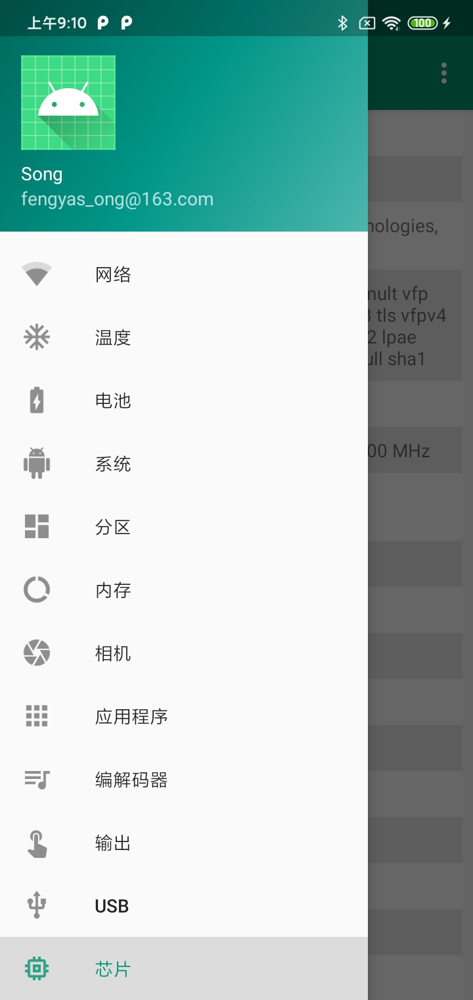
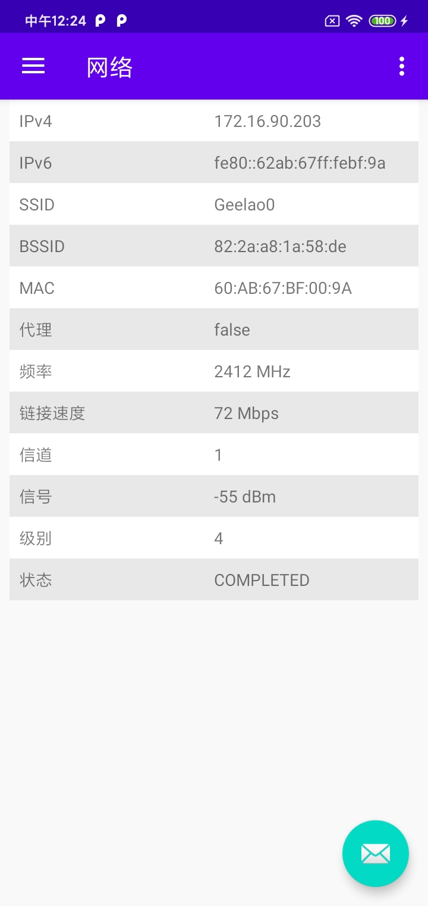
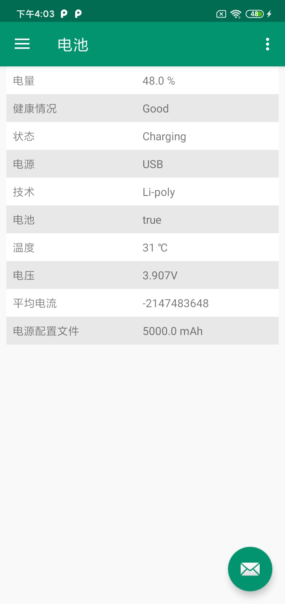
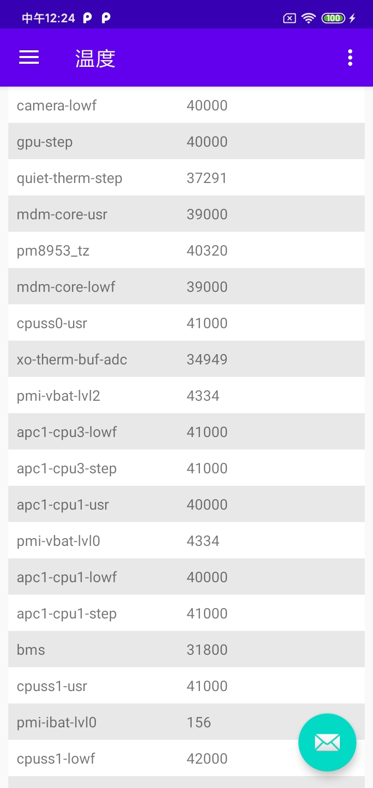

# 设备信息采集工具

一个用于采集 Android 设备硬件、系统、网络、安全等全方位信息的工具类应用，可帮助开发者排查问题、进行设备识别与风控分析。

<div align="center">

[](https://github.com/song-dev/device-info/issues)
[](https://github.com/song-dev/device-info/network)
[](https://github.com/song-dev/device-info/stargazers)
[](https://www.apache.org/licenses/LICENSE-2.0.html)

</div>

## 功能特性

采集的信息覆盖以下维度，均以可视化列表呈现，支持下拉刷新：

### 硬件信息
- 设备信息（型号、品牌、指纹、SOC 平台）
- 电池信息、温度监控、CPU 频率
- 相机信息、编解码器信息
- 输入设备信息、USB 设备信息
- 存储分区信息、内存信息

### 系统信息
- 系统参数（版本、API、构建信息）
- 网络信息（WIFI、蓝牙、移动网络、代理）
- 应用信息、应用列表

### 安全与风控
- 模拟器检测（多方案：QEMU、文件特征、ARM 特征等）
- 多开/虚拟环境检测
- Root 检测、Hook 检测、Xposed 检测
- Debug 调试状态检测
- 地图（Maps）信息、SOC 芯片信息

## 技术栈

| 类别 | 技术 |
|------|------|
| 语言 | Kotlin |
| UI 架构 | MVVM + ViewBinding + Navigation |
| 异步 | Kotlin Coroutines |
| 网络 | OkHttp |
| 构建 | Gradle 8.9 + Kotlin DSL + Version Catalog |
| 其他 | Firebase Performance、Bugly、DoraemonKit |

## 信息采集模块

- 网络信息
- 电池信息
- 温度监控信息
- 系统参数信息
- 分区文件信息
- 内存信息
- 应用程序信息
- 输出驱动信息采集
- USB 设备信息采集
- 芯片信息采集
- 模拟器信息采集
- 多开信息采集
- debug 信息采集
- root 信息采集
- hook 信息采集
- 设备信息采集
- 应用信息采集
- WIFI、蓝牙扫描
- 其他信息类采集
- 相机信息采集
- SOC 信息采集
- Build 信息采集
- Maps 信息采集
- 硬件信息采集

> 后续还会不断添加

## 构建说明

环境要求：
- Android Studio 或命令行 Gradle
- JDK 8+
- Android SDK（compileSdk 34）

```bash
# 编译 debug 包
./gradlew assembleDebug

# 编译 release 包（签名配置在 app/build.gradle.kts）
./gradlew assembleRelease
```

构建产物输出到 `app/build/outputs/apk/`，命名格式为 `device_info_<版本号>_<日期>.apk`。

## 截图









## ChangeLog

版本 | 更新内容 | 更新日期
-----|-----|-----
**0.2.2** | 1、适配 OPPO 机型安装；<br>2、升级 Gradle 构建工具链；<br>3、Java 代码全面迁移为 Kotlin；<br>4、优化项目结构 | 2026-10-15
**0.2.1** | 1、新增 Logcat 日志打印；<br>2、Build 信息采集；<br>3、Maps 信息采集；<br>4、硬件信息采集 | 2021-10-12
**0.2.0** | 1、设备信息采集；<br>2、应用信息采集；<br>3、WIFi、蓝牙扫描；<br>4、相机、SOC 信息采集 | 2020-11-12
**0.1.10** | 1、debug 信息采集；<br>2、root 信息采集；<br>3、hook 信息采集；<br>4、新增应用内语言切换 | 2020-08-27
**0.1.9** | 1、多开信息采集；<br>2、模拟器信息采集 | 2020-07-14
**0.1.8** | 1、USB 设备信息采集； | 2020-06-08
**0.1.7** | 1、输出驱动信息采集； | 2020-06-05
**0.1.6** | 1、编解码器信息采集； | 2020-06-03
**0.1.5** | 1、应用程序信息采集； | 2020-06-03
**0.1.4** | 1、内存信息采集； | 2020-06-02
**0.1.3** | 1、分区文件信息采集； | 2020-06-01
**0.1.2** | 1、新增电池信息采集模块；<br>2、新增系统信息采集模块 | 2020-05-28
**0.1.1** | 1、新增温度信息采集模块 | 2020-05-27
**0.1.0** | 1、搭建整体框架；<br>2、新增网络信息采集模块 | 2020-05-26
